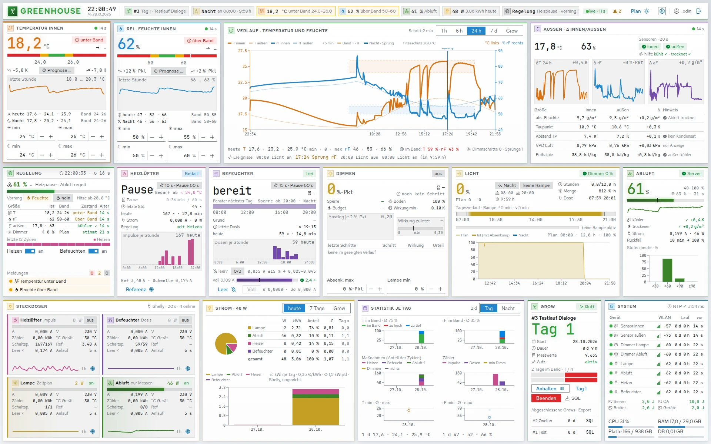
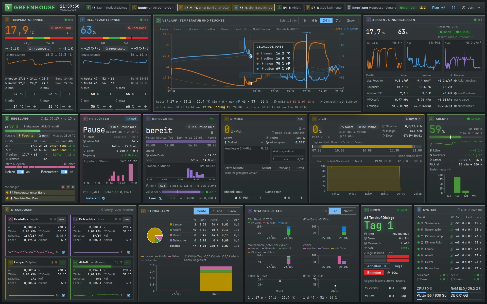

<p align="center">
  
</p>

<h1 align="center">Carbide UI</h1>

<p align="center">
  React components for control rooms, administration and work in the field.<br />
  Light and dark themes, three densities, plant symbols with live states.
</p>

<p align="center">
  <a href="https://showcase.growdog.tech/carbide-ui/"><strong>Open the Storybook</strong></a>
  ·
  <a href="#quick-start">Quick start</a>
  ·
  <a href="#packages">Packages</a>
</p>

<p align="center">
  <a href="https://www.npmjs.com/package/@odinscode/carbide-core"></a>
  <a href="LICENSE"></a>
  
  
</p>

<p align="center">
  
</p>

<p align="center">
  
</p>

<p align="center">
  <sub>A climate control dashboard built with Carbide UI, in the light and the dark theme.</sub>
</p>

## What's inside

| | |
|---|---|
| **64 components** | Forms, dialogs, menus, navigation, a data grid with sorting, filters, selection and virtual scrolling, calendar, wizard, tree, toasts |
| **Charts** | Line, area, bar, pie, ranking, sparkline, gauge, timeline, meters with a target band |
| **Page shells** | AdminShell, BoardShell and FieldShell for administration, control room and field, plus list and object pages |
| **Plant symbols** | Pumps, valves, tanks, piping, filters, heat exchangers and displays, each with states such as `running`, `warning`, `alarm` and `fault` |
| **Design tokens** | Colors, spacing, typography, motion and status colors as CSS custom properties, with the Carbide Sans, Display and Mono typefaces |

## Themes and density

Every component comes in a light and a dark theme and in three densities: `compact`, `dense` and `large`. Without a setting, the theme follows the operating system. An application sets both with `data-theme` and `data-density` on any element, also for just one part of a page.

## Plant symbols

The symbols are React components on a shared grid. Their connections always sit in the same places, so they line up into piping diagrams. The state comes in as a prop, the colors come from the tokens. A running centrifugal pump turns its impeller.

## Quick start

Install the tokens and the components with npm:

```bash
npm install @odinscode/carbide-token @odinscode/carbide-core react react-dom
```

The same with pnpm or Yarn:

```bash
pnpm add @odinscode/carbide-token @odinscode/carbide-core react react-dom
yarn add @odinscode/carbide-token @odinscode/carbide-core react react-dom
```

Add `@odinscode/carbide-shell`, `@odinscode/carbide-icons-scada` or `@odinscode/carbide-home` when you need page shells, plant symbols or the home components.

```tsx
import "@odinscode/carbide-token/css/tokens.css";
import { Button, TextInput } from "@odinscode/carbide-core";

export function Login() {
  return (
    <form>
      <TextInput label="Login" autoComplete="username" />
      <Button variant="primary" type="submit">
        Sign in
      </Button>
    </form>
  );
}
```

Import the tokens once. Every component brings its own CSS.

## Packages

| Package | Contents |
|---|---|
| [`@odinscode/carbide-token`](https://www.npmjs.com/package/@odinscode/carbide-token) | Design tokens as CSS custom properties, and the typefaces |
| [`@odinscode/carbide-core`](https://www.npmjs.com/package/@odinscode/carbide-core) | Components, data grid and charts |
| [`@odinscode/carbide-shell`](https://www.npmjs.com/package/@odinscode/carbide-shell) | Page shells: AdminShell, BoardShell, FieldShell, list and object pages |
| [`@odinscode/carbide-icons-scada`](https://www.npmjs.com/package/@odinscode/carbide-icons-scada) | Plant symbols with states |
| [`@odinscode/carbide-home`](https://www.npmjs.com/package/@odinscode/carbide-home) | HomeShell, navigation and dashboard for home applications |

`carbide-shell` and `carbide-home` build on `carbide-core`; `carbide-icons-scada` needs only the tokens.

## Foundations

- **Accessibility:** the interactive components build on [Ark UI](https://ark-ui.com/), which provides keyboard handling, focus management and ARIA roles.
- **Data:** the data grid uses [TanStack Table](https://tanstack.com/table) and [TanStack Virtual](https://tanstack.com/virtual), the charts use [Recharts](https://recharts.org/).
- **Types:** every package ships its TypeScript types. CSS module classes are named exactly like their access in code.
- **Tested:** every component has stories, including a matrix of both themes and all three densities, and every story also runs as a test.

## Development

```bash
pnpm install
pnpm dev          # Storybook on http://localhost:6006
```

| Command | Purpose |
|---|---|
| `pnpm test` | Run the tests once |
| `pnpm check` | Lint and format check |
| `pnpm typecheck` | Type check across all packages |
| `pnpm build` | Build all packages into `packages/*/dist/` |
| `pnpm build-storybook` | Static Storybook into `dist-storybook/` |

A change to a package comes with a changeset file, see [`.changeset/README.md`](.changeset/README.md).

## License

Carbide UI is licensed under the [Apache License 2.0](LICENSE), copyright 2026 Vitali Wottschel. The typefaces in `carbide-token` are licensed under the SIL Open Font License 1.1. Third-party components and their license terms are listed in [LIZENZEN.md](LIZENZEN.md) (German).
